# BuscaPet — Manual do Usuário — versão 1.0

Equipe: Kaian Guthierry da Silva — 01617843; Nivaldo José de Arruda Filho — 01486768; Marlon Porto Torres — 01611478.

> Versão em Markdown do PDF (`BuscaPet-Manual-do-Usuario.pdf`, nesta pasta). Gerada do mesmo conteúdo.

## 1. O que é o BuscaPet

O BuscaPet é um site, que também pode ser instalado no celular como aplicativo, que junta num só lugar três formas de ajudar os animais de Recife e região:

- **Adoção:** abrigos e protetores mostram os animais disponíveis; quem quer adotar encontra, conhece e demonstra interesse.
- **Perdidos e achados:** quem perdeu um animal ou viu um animal na rua registra com foto e local. O BuscaPet compara as fotos e mostra os animais mais parecidos, e avisa quando aparece um novo.
- **Doações:** abrigos verificados publicam o que precisam (ração, remédios, dinheiro para as contas do mês) e quem quer ajudar doa. As doações confirmadas aparecem no ranking de quem apoia.

O BuscaPet **nunca afirma** que encontrou o seu animal: ele mostra os mais parecidos, do mais para o menos parecido, e quem reconhece é você. Também **não recebe pagamentos**: doação em dinheiro é feita por PIX, direto do seu banco para o abrigo.

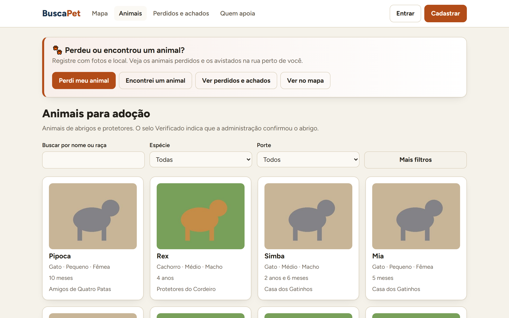

*Página inicial: animais para adoção e o atalho para perdidos e achados*

## 2. Para quem é

| Perfil | Quem é | O que pode fazer |
|---|---|---|
| Visitante | qualquer pessoa, sem conta | ver animais, mapa, perdidos e achados, ranking e mural de necessidades; preencher um registro de perdido ou avistado (a conta só é pedida na hora de publicar) |
| Tutor | pessoa que quer adotar, perdeu ou viu um animal, ou quer doar | demonstrar interesse em adotar, registrar perdidos e avistados, receber alertas, doar itens e dinheiro, aparecer no ranking de pessoa física |
| Abrigo | abrigo ou protetor independente | cadastrar animais com fotos, responder interessados, publicar necessidades e a meta do mês (com o selo Verificado), confirmar doações, ver relatórios |
| Apoiador | empresa: pet shop, clínica veterinária ou distribuidora | doar pelo mural e aparecer no ranking da sua categoria, com perfil público |
| Administração | equipe que cuida da plataforma | verificar abrigos (selo), analisar denúncias, ver o painel, os relatórios e o histórico, consultar contas |

## 3. Acesso e conta

### 3.1 Criar a conta

- Clique em **Cadastrar** (canto superior direito).
- Escolha o **tipo de conta**: Tutor, Abrigo / protetor ou Apoiador. O tipo não muda depois.
- Preencha nome, e-mail e senha (mínimo de 8 caracteres). Abrigo informa também nome do abrigo e endereço (com o botão "Usar minha localização" para marcar no mapa); apoiador informa CNPJ e o tipo de estabelecimento.
- Clique em **Criar conta**: você já entra logado.

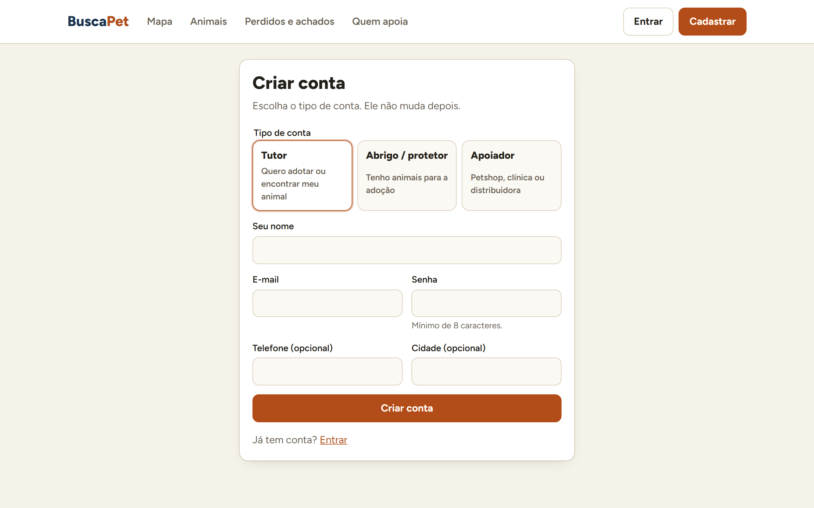

*Cadastro: o tipo de conta define o que você pode fazer*

### 3.2 Entrar, sair e recuperar a senha

- **Entrar:** um só login para todos os perfis: e-mail e senha. O botão **Mostrar** exibe a senha digitada.
- **Esqueci minha senha:** informe o e-mail; chega um link que vale 30 minutos e funciona uma vez só.
- **Sair:** no menu da conta (o botão com a sua inicial e ☰), última opção.

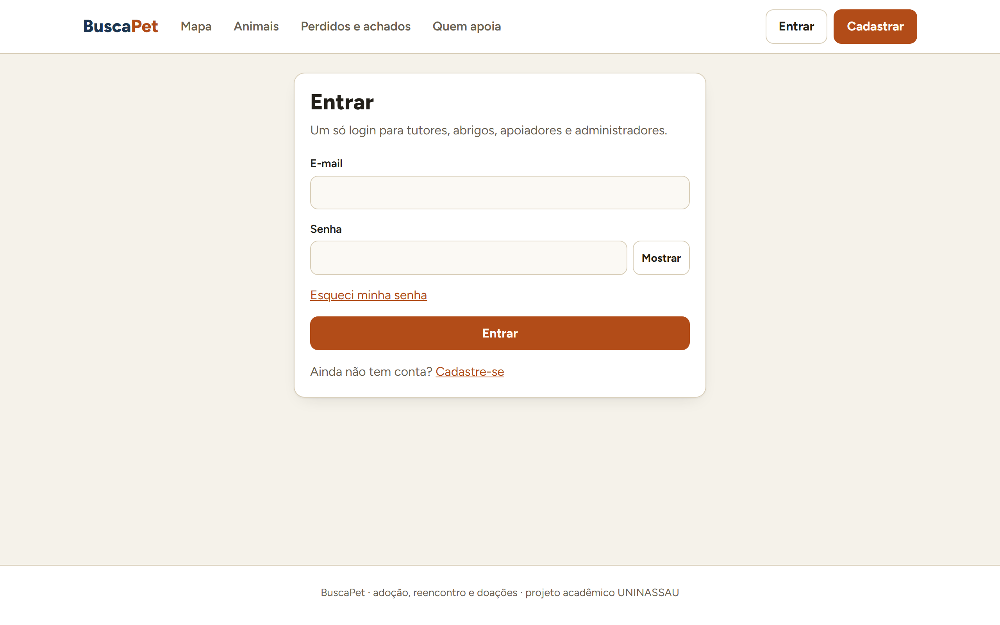

*Tela de entrada*

### 3.3 Menu da conta e Minha conta

O botão com a sua inicial abre o **menu da conta**, com os atalhos do seu perfil. Em **Minha conta** você altera os seus dados (e, no abrigo, o perfil público e a chave PIX), troca a senha ou exclui a conta. O **sino** mostra quantos avisos você ainda não leu.

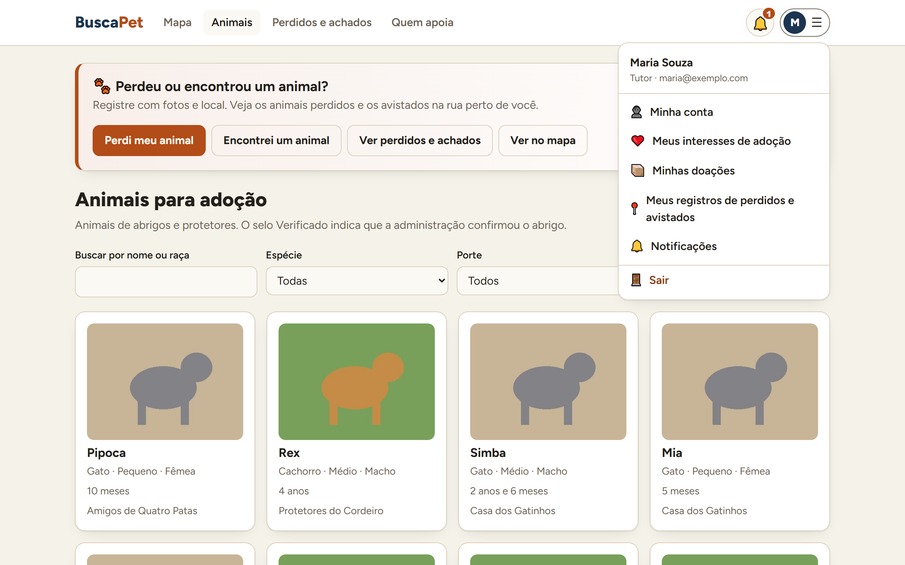

*Menu da conta do tutor*

## 4. Adotar um animal

- Na página **Animais**, use a busca e os filtros (espécie, porte, sexo, idade e outros em "Mais filtros"). O selo **Verificado** indica que a administração conferiu o abrigo.
- Clique no animal para abrir a ficha: fotos, características, temperamento e o abrigo.
- Clique em **Tenho interesse** e, se quiser, escreva uma apresentação (onde mora, rotina, outros animais).
- O abrigo recebe o aviso e responde. Acompanhe em **Meus interesses de adoção**: Aguardando resposta → Em conversa → Aprovado (ou Não seguiu). Com o interesse registrado, você vê o telefone e o WhatsApp do abrigo.

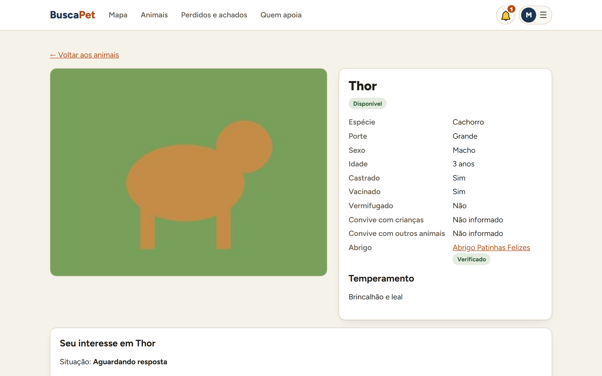

*Ficha do animal com o botão Tenho interesse*

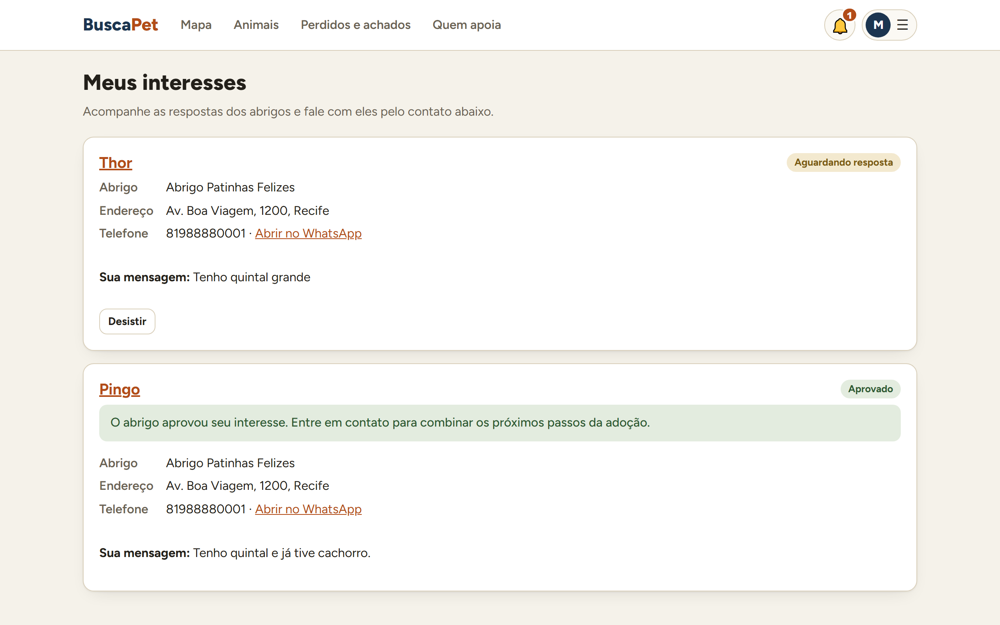

*Meus interesses: a situação de cada pedido de adoção*

## 5. Perdi ou encontrei um animal

### 5.1 Registrar

Em **Perdidos e achados**, escolha **Perdi meu animal** ou **Encontrei um animal**. O registro tem 5 etapas: **Fotos → Características → Local e data → Revisar → Resultados**. Você pode preencher tudo sem conta; o login é pedido na etapa Revisar, e as fotos continuam lá.

- **Fotos:** de 1 a 5, JPEG, PNG ou WebP, até 8 MB cada. Prefira o corpo inteiro, com boa luz e de ângulos diferentes: é isso que a comparação usa. A localização gravada dentro da foto pelo celular é apagada no envio.
- **Características:** espécie, porte, cor, pelagem e sinais particulares (coleira, cicatriz, mancha).
- **Local e data:** marque no mapa onde o animal sumiu ou foi visto. O público vê só um ponto **aproximado**, para proteger o seu endereço; o local exato fica só para você.
- **Resultados:** os animais mais parecidos (avistados e de abrigos), com o grau de semelhança (alta, média ou baixa) e a distância.

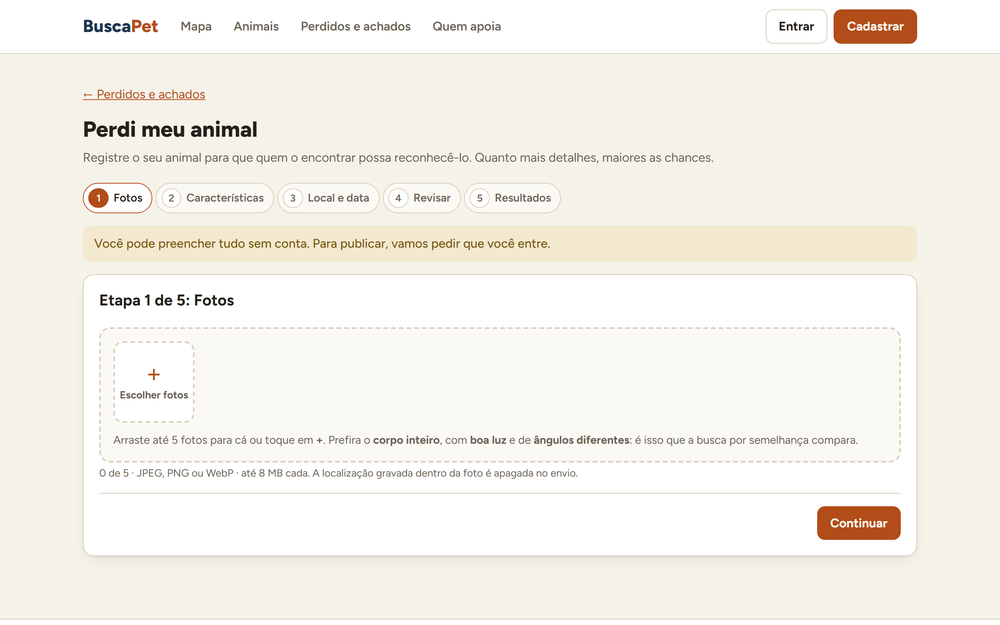

*Perdi meu animal: etapa 1 de 5*

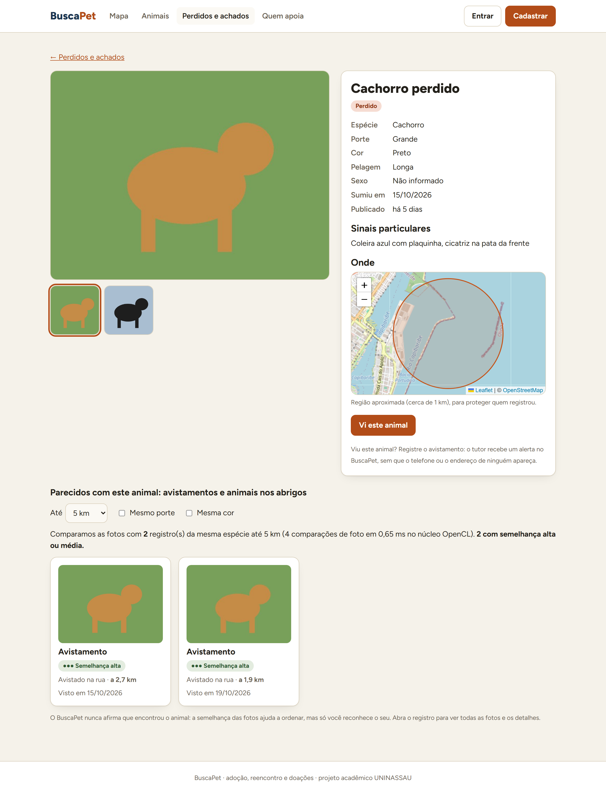

*Registro de um animal perdido com os parecidos encontrados pela comparação de fotos*

### 5.2 Alertas e caso resolvido

- Quando alguém registra um avistamento parecido com o seu animal perto de onde ele sumiu, você recebe um **alerta** no sino.
- Em **Meus registros** ficam os seus perdidos e avistados. Encontrou o animal? Clique em **Encontrei meu animal**: o caso sai da lista pública.
- No **Mapa**, a aba **Perdidos e avistados** mostra os registros no mapa e em lista, com filtros e o botão **Perto de mim**.

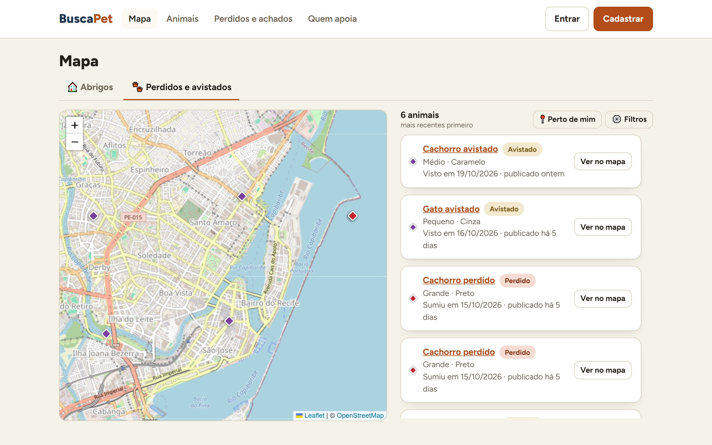

*Mapa: perdidos e avistados*

## 6. Doar

### 6.1 Doar itens

- No **Quem apoia** (mural) ou no perfil do abrigo, escolha uma necessidade, informe a quantidade e clique em **Quero doar**.
- Combine a entrega pelo contato do abrigo, que aparece em **Minhas doações**.
- Quando o abrigo confirmar que recebeu, a doação conta para a necessidade e para o ranking.

### 6.2 Doar dinheiro (PIX)

- No perfil de um abrigo verificado aparecem a **meta do mês** (quanto ele precisa e para quê) e a **chave PIX**, com o botão **Copiar**.
- Faça o PIX pelo app do seu banco. O BuscaPet não recebe nem repassa dinheiro.
- Volte ao perfil e, em "Já fez o PIX? Informe o valor", digite o valor (ex.: 50,00) e clique em **Informar doação**.
- O abrigo confere a conta e confirma; aí a meta avança e a doação entra no ranking.

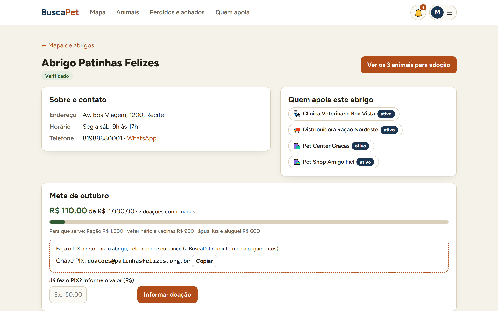

*Perfil do abrigo: meta do mês, chave PIX e o campo para informar a doação*

### 6.3 Ranking de quem apoia

Pontos: 10 por doação confirmada (itens ou dinheiro) + 10 por mês seguido doando; manter a constância vale tanto quanto doar mais. Há uma aba por categoria (petshop, clínica, distribuidora e **pessoa física**), no mês e no ano. Pessoas físicas aparecem só com o primeiro nome e a inicial do sobrenome.

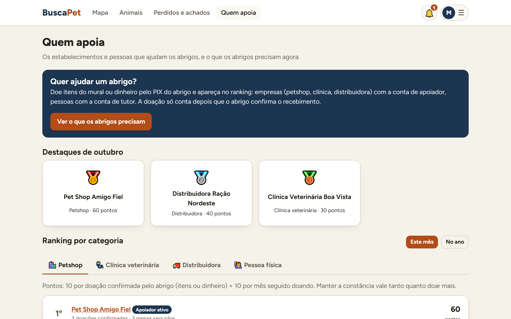

*Quem apoia: destaques do mês e ranking por categoria*

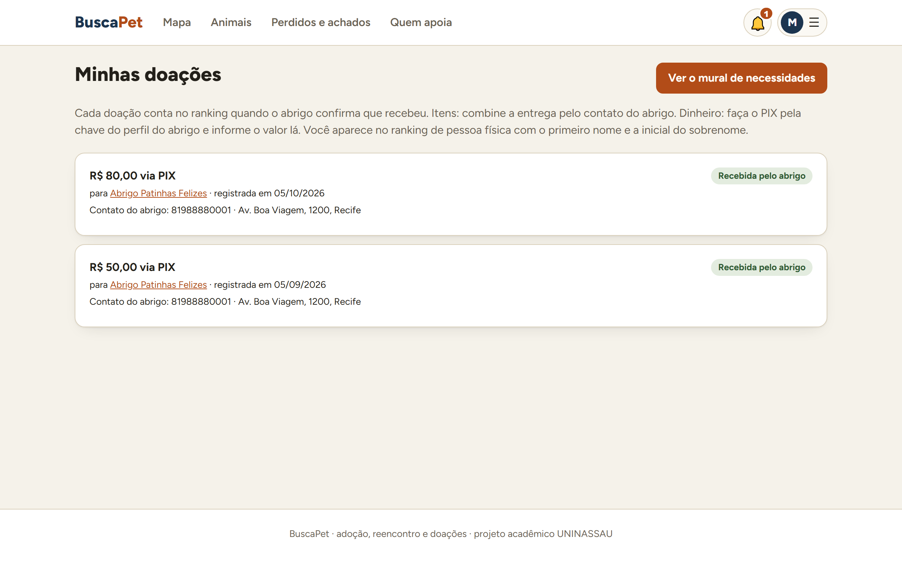

*Minhas doações: a situação de cada doação*

## 7. Para abrigos

### 7.1 Cadastrar e cuidar dos animais

- Em **Meus animais**, preencha "Cadastrar animal" e clique em **Cadastrar**. O animal já aparece no catálogo.
- Clique em **Editar** para mudar os dados e a situação (Disponível, Em processo de adoção, Adotado, Transferido ou Óbito) e para **adicionar fotos** (até 5). A primeira é a capa; use **Tornar capa** para trocar.
- Quando uma foto de animal seu é parecida com a de um animal perdido, o tutor é avisado, e você também.

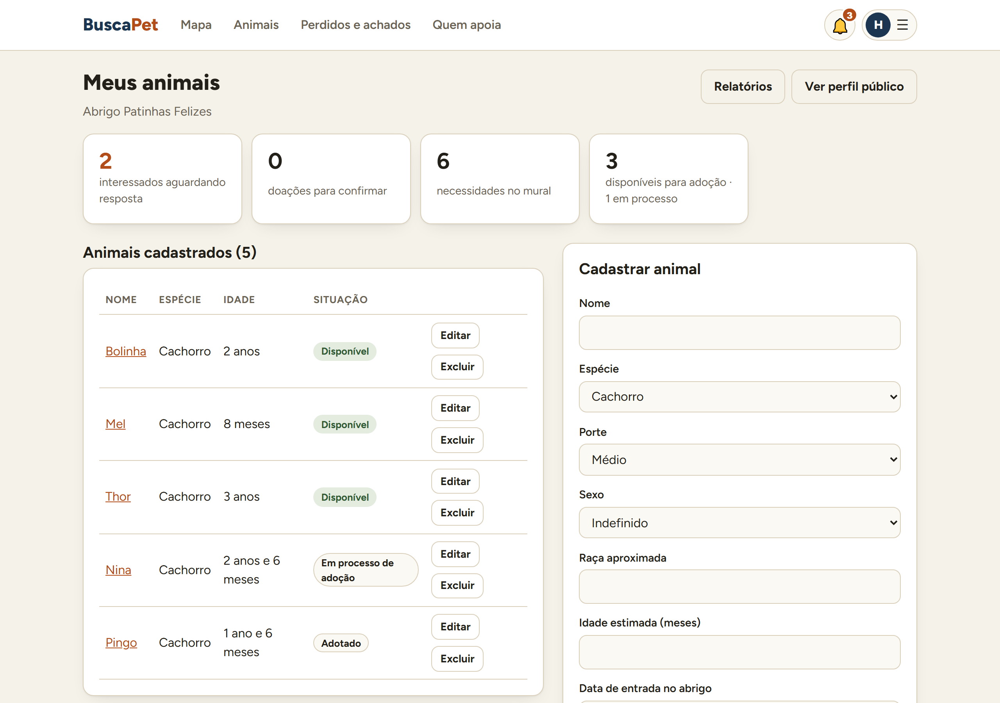

*Meus animais: resumo do dia, lista e cadastro*

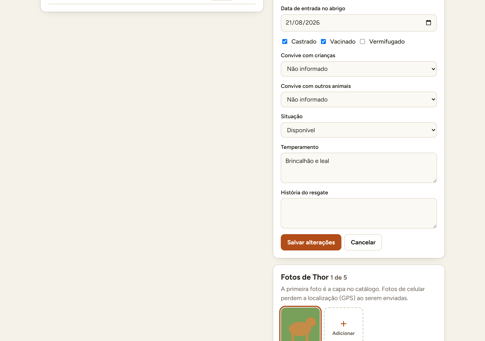

*Edição do animal com as fotos*

### 7.2 Responder interessados

Em **Interessados**, cada pedido mostra o animal, a apresentação e o contato da pessoa. Use **Iniciar conversa**, **Aprovar** ou **Recusar**; a pessoa é avisada a cada mudança. Ao aprovar, o animal passa para "em processo de adoção".

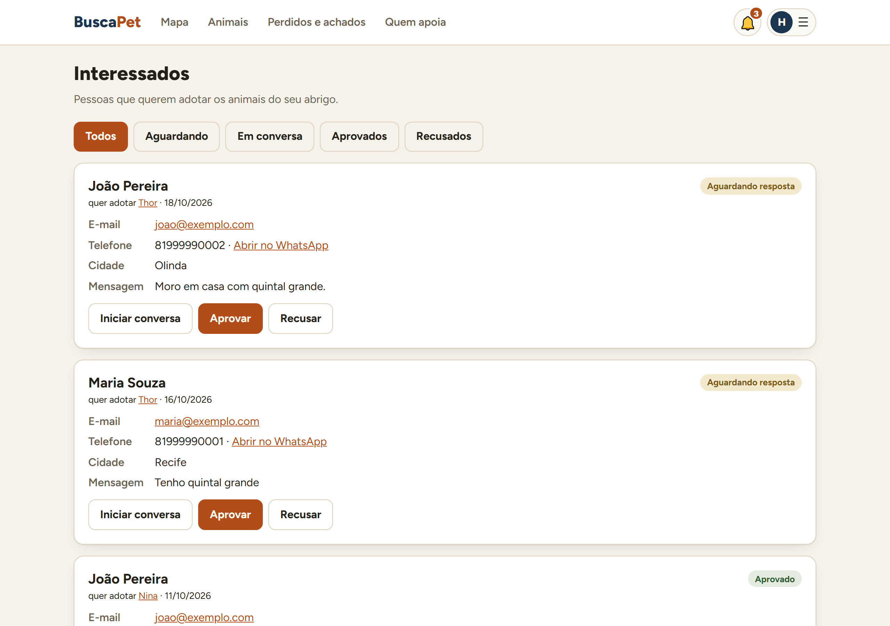

*Interessados: responder cada pedido*

### 7.3 Necessidades, meta do mês e doações

- O **selo Verificado** é concedido pela administração depois de conferir o abrigo. Com ele, o abrigo publica no mural, mostra a chave PIX e recebe doações.
- Em **Necessidades e doações**: defina a **meta do mês** (valor e para que serve), publique necessidades com a urgência, marque como atendida ou exclua.
- Em **Doações para confirmar**, clique em **Confirmar recebimento** (itens) ou **Confirmar: o PIX chegou** (dinheiro) só quando receber de verdade. **Não recebi** recusa. As anteriores ficam no histórico.
- A chave PIX é cadastrada em **Minha conta**.

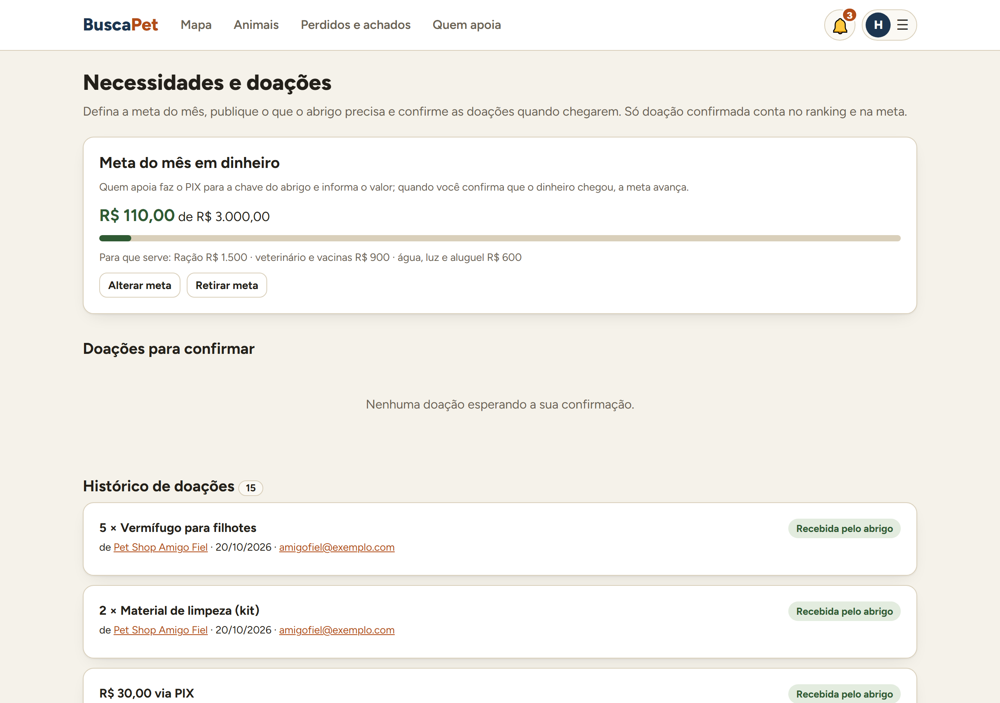

*Necessidades e doações: meta do mês, pendentes e histórico*

### 7.4 Relatórios

Em **Relatórios**, escolha o período (30 dias, 90 dias, este ano ou datas) e veja animais, interesses, adoções e o tempo médio até a adoção, doações e quem apoia, com gráficos. Os botões de exportação geram planilhas (CSV) que abrem no Excel. A aba **Histórico de operações** mostra o que foi feito na conta do abrigo.

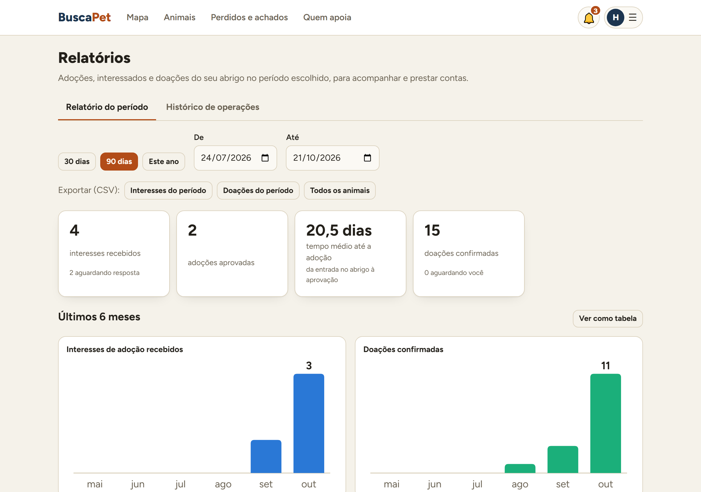

*Relatórios do abrigo*

## 8. Para apoiadores

A conta de apoiador é de empresa (CNPJ). Doe pelo mural do **Quem apoia** ou pelo perfil de um abrigo; acompanhe em **Minhas doações**. O **Meu perfil público** mostra os pontos, os meses seguidos doando e os abrigos apoiados, e o selo **Apoiador ativo** aparece para quem teve doação confirmada neste mês ou no anterior.

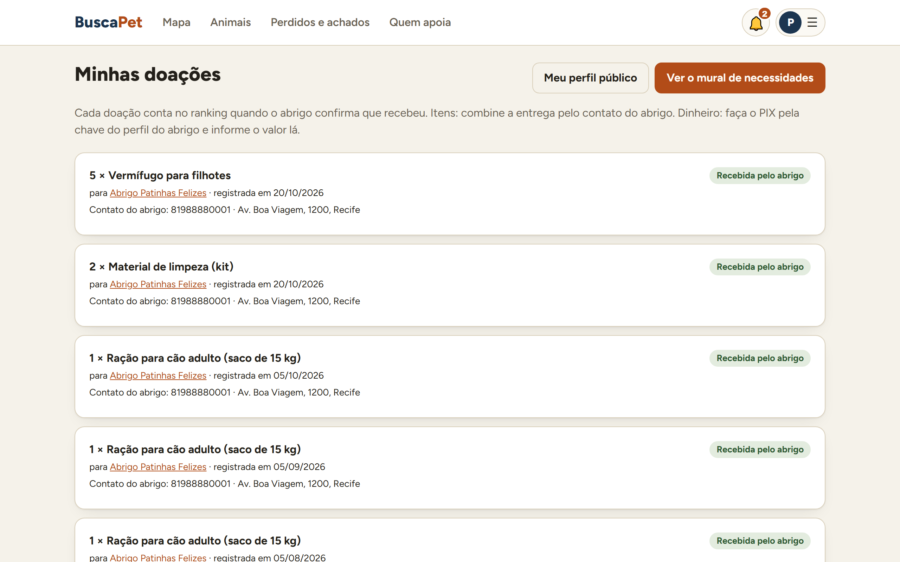

*Minhas doações do apoiador*

## 9. Para a administração

- **Painel:** números do período e de agora, gráficos dos últimos 6 meses e as últimas ações.
- **Verificar abrigos:** **Verificar** concede o selo; **Suspender** tira o abrigo do catálogo. O abrigo é avisado.
- **Denúncias:** cada anúncio denunciado com os motivos; decida entre remover o anúncio, advertir o abrigo, banir (remove e suspende) ou ignorar.
- **Histórico de operações:** quem fez o quê e quando, com pesquisa e exportação.
- **Contas:** pesquisa por nome, e-mail, tipo e situação.
- **Núcleo OpenCL:** estado do serviço que compara as fotos e o teste de desempenho (comparação feita em um núcleo do processador × em todos os núcleos ao mesmo tempo).

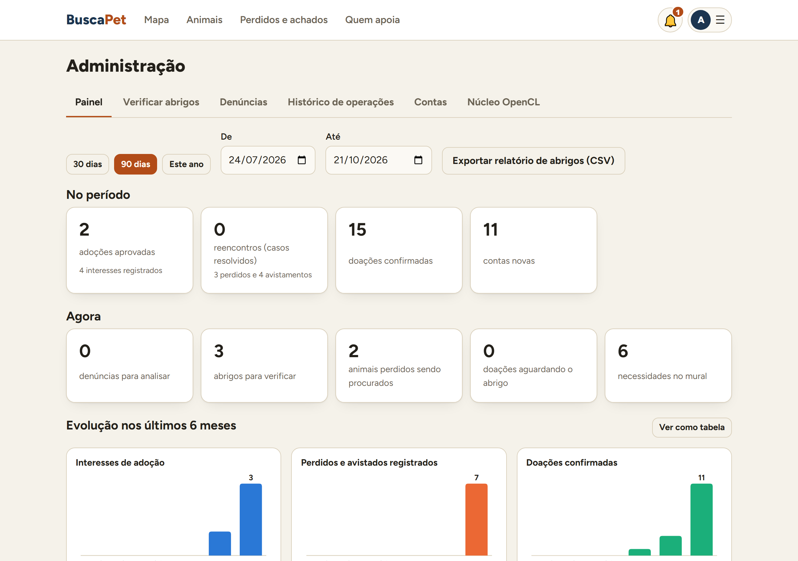

*Painel da administração*

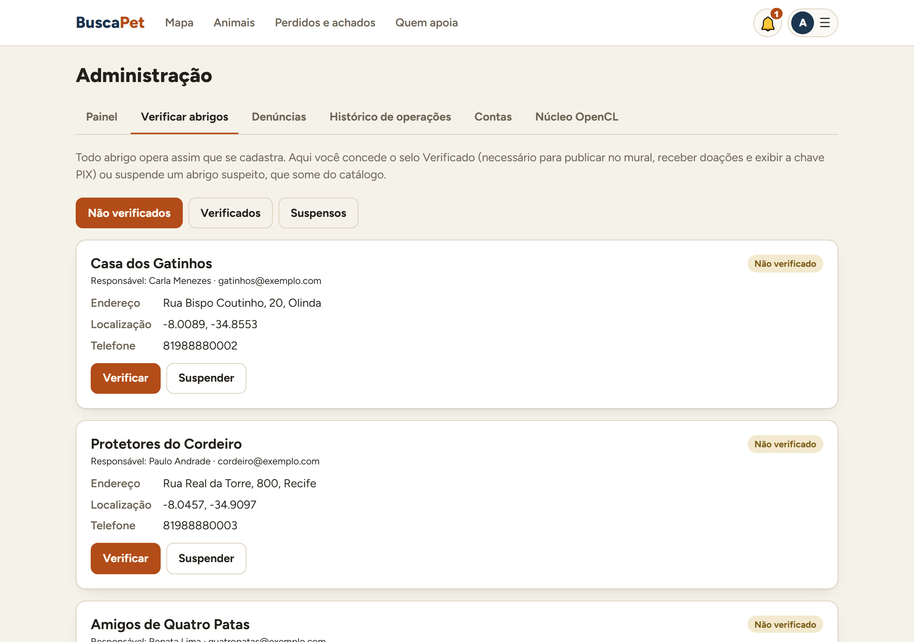

*Verificar abrigos*

## 10. Mensagens, validações e situações comuns

As mensagens aparecem em faixas coloridas: **verde** quando deu certo, **amarela** para avisos e **vermelha** para erros. O campo com problema fica destacado.

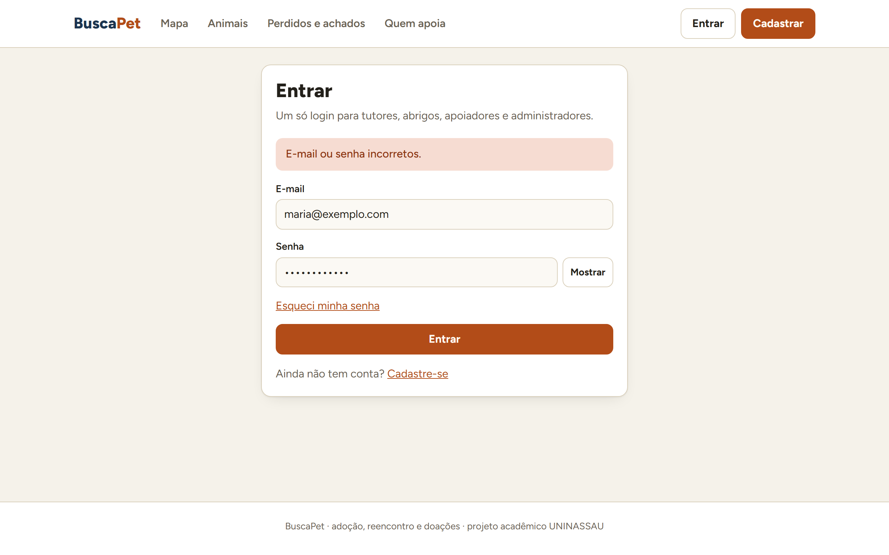

*Exemplo de mensagem de erro*

| Mensagem | O que significa / o que fazer |
|---|---|
| E-mail ou senha incorretos. | Confira o e-mail e a senha (o botão Mostrar ajuda). Esqueceu? Use "Esqueci minha senha". |
| Já existe uma conta com este e-mail. | Use "Entrar" ou recupere a senha. |
| CNPJ inválido. / Já existe um apoiador com este CNPJ. | Confira os 14 dígitos do CNPJ. |
| Pessoa física doa com uma conta de tutor… | A conta de apoiador é só para empresas; pessoas doam com a conta de tutor. |
| Escolha pelo menos uma foto. / cada foto pode ter no máximo 8 MB. | Envie de 1 a 5 fotos JPEG, PNG ou WebP, até 8 MB cada. |
| Este animal não está mais disponível para adoção. | Ele foi adotado ou está em processo; veja outros no catálogo. |
| Este abrigo ainda não tem o selo Verificado… | Só abrigos verificados recebem doações pela plataforma. |
| Esta necessidade já foi atendida. Veja outras no mural. | Outra pessoa completou o pedido antes; escolha outra necessidade. |
| Este link é inválido, já foi usado ou expirou. Peça um novo. | O link de nova senha vale 30 minutos e uma vez só. |
| Seu tipo de conta não tem acesso a esta página. | A página é de outro perfil (por exemplo, a área do abrigo). |
| Você está sem internet… | A conexão caiu; tente de novo quando voltar. |
| Página não encontrada | O endereço está errado ou o conteúdo foi removido; use os botões para voltar. |

### 10.1 Perguntas frequentes

- **O BuscaPet diz que achou meu animal?** Não. Ele mostra os mais parecidos; quem reconhece é você.
- **Meu endereço aparece?** Não. Perdidos e avistados mostram um ponto aproximado ao público.
- **Por que minha doação ainda não pontuou?** Ela só conta quando o abrigo confirma que recebeu.
- **Como instalo no celular?** No rodapé, "Instalar app" (Chrome/Edge); no iPhone, pelo menu Compartilhar do Safari → "Adicionar à Tela de Início".
- **Vi um anúncio estranho (cobrança, golpe).** Na ficha do animal, "Denunciar este anúncio": a administração analisa.

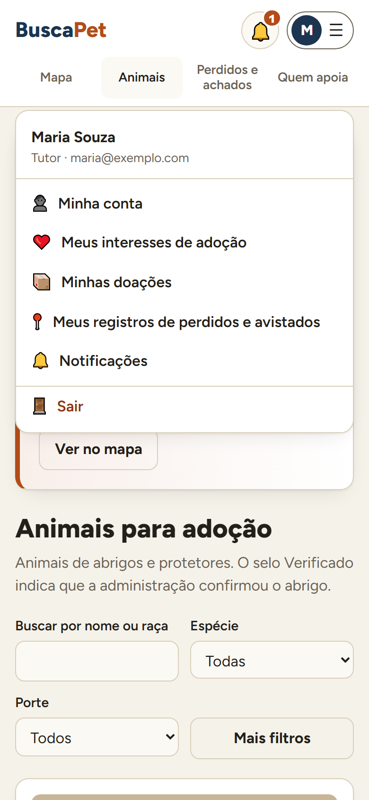

*No celular, o menu da conta*
