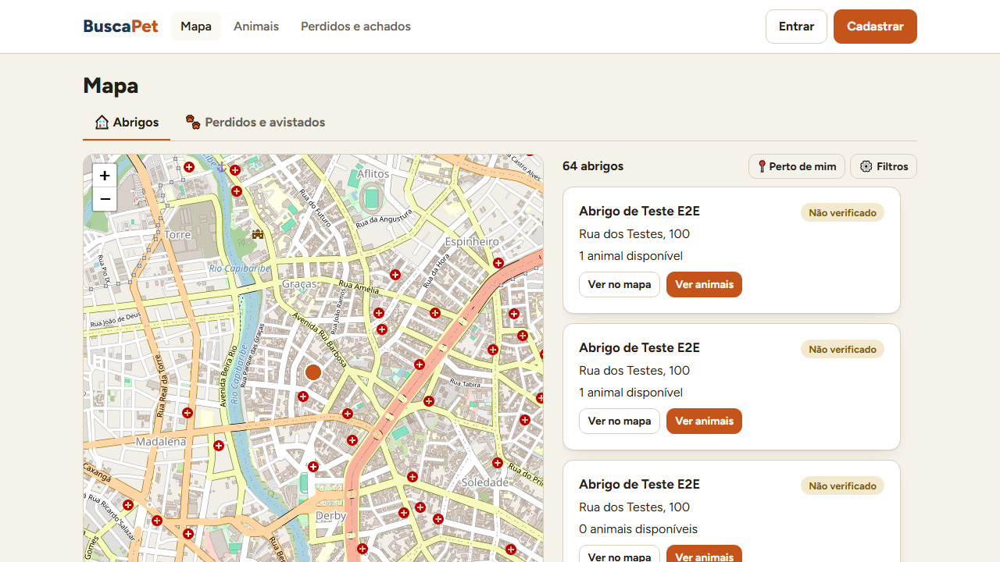
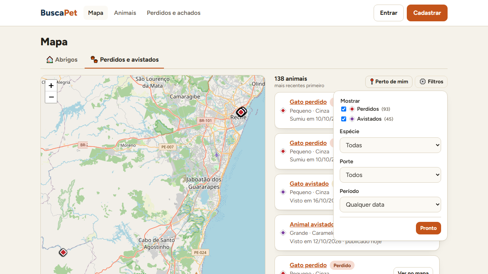
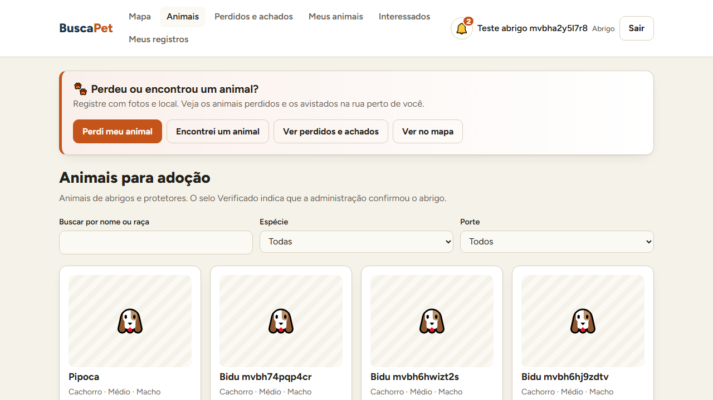
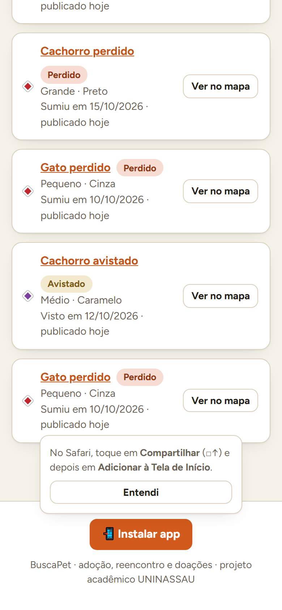
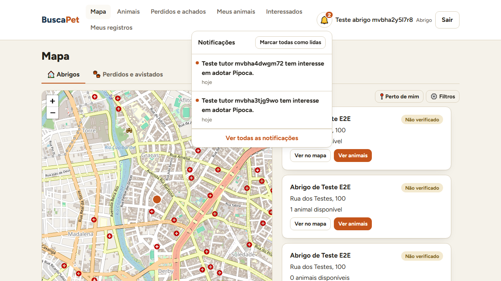
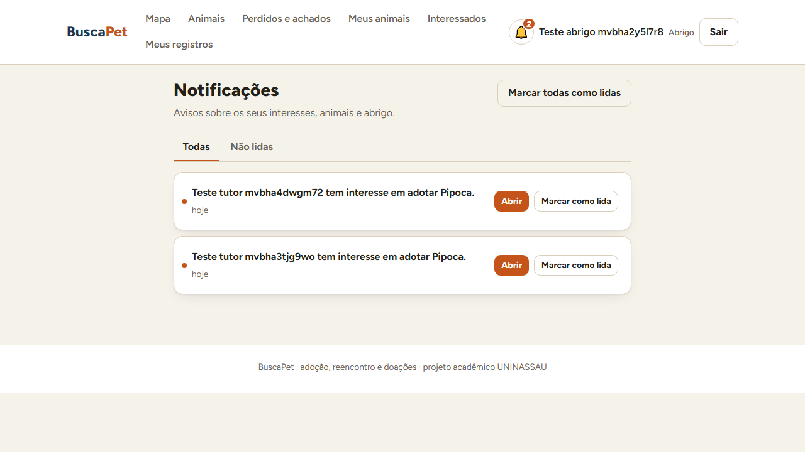

# Mapa com abas, app instalável, notificações e testes de ponta a ponta

**Data:** 16/10/2026 · **Responsável:** Kaian (P2) · **Código:** `BuscaPet-App`, PRs `feature/e2e-playwright`,
`feature/mapa-camadas-reencontro`, `feature/pwa-instalar` e `feature/notificacoes` (empilhados, nessa ordem)
**Requisitos:** RF-07 a RF-09 (mapa e camadas), RF-36 (notificações); RNF de usabilidade em celular

> As capturas foram feitas no ambiente de testes, que acumula registros de exemplo. Por isso aparecem muitos
> "Gato perdido" e "Abrigo de Teste E2E".

---

## 1. Mapa: a porta de entrada

O protótipo da Sprint 2 (`03-inicio`) previa o mapa como tela principal, com abas por camada e lista lateral
sincronizada. Agora:

| | |
|---|---|
|  |  |

- **Mapa** é o primeiro item do menu. Acima do mapa ficam **só as abas**: 🏠 Abrigos e 🐾 Perdidos e avistados.
- Sobre a lista, numa linha: a **contagem** à esquerda; **📍 Perto de mim** (liga/desliga) e **⚙️ Filtros** à direita.
- **Filtros** abre um painel. Para animais: Perdidos/Avistados, espécie, porte, período e distância. Para
  abrigos: só verificados, só com animais disponíveis e distância. O botão mostra quantos filtros estão ligados.
- A aba de animais tem uma **lista mista** (perdidos e avistados juntos, com etiqueta), do mais perto ao mais longe
  quando há posição, senão dos mais recentes.
- Perdidos e avistados aparecem como **losangos** (vermelho e roxo), e os abrigos como círculos: a forma diferencia
  mesmo para quem não distingue cores.
- A aba e o filtro de tipo vão para a URL (`/mapa?ver=animais&mostrar=perdidos`), o que permite compartilhar o link.

**Como chegamos aqui.** A primeira versão tinha camadas que ligavam e desligavam juntas, e a segunda tinha chips e
selects acima do mapa, que quebravam a linha. Na revisão das telas, ficou decidido: menos botões em cima, mapa
maior e as opções num painel, como nos apps de compra.

## 2. App instalável (PWA)

| Página inicial com o destaque do reencontro | Dica de instalação no iPhone |
|---|---|
|  |  |

- **Manifesto** com nome, cores, ícones gerados do logo oficial (inclusive *maskable* para Android e
  `apple-touch-icon` para iPhone) e atalhos (Perdi meu animal, Encontrei um animal, Mapa).
- **Service worker** só em produção: a casca da interface abre **sem internet** (verificado), e os arquivos com hash
  ficam em cache. A API e o mapa sempre passam direto, para os dados nunca ficarem velhos.
- **"Instalar app"** fica no rodapé, centralizado. No Android/Chrome/Edge usa o pedido do navegador; no iPhone
  mostra o passo a passo do Safari (a Apple não deixa o site pedir).
- **E o OpenCL no celular?** O celular não roda OpenCL: ele só envia a foto, e o núcleo (C + PoCL) compara no
  **servidor**. Assim o resultado é igual em qualquer aparelho e a bateria não é gasta. Detalhes em
  `BuscaPet-App/frontend/README.md`.

## 3. Notificações (RF-36)

| Sino com as recentes | Página de notificações |
|---|---|
|  |  |

As notificações já eram gravadas desde a Sprint 4, mas não havia como lê-las. Agora:

| Rota | Função |
|---|---|
| `GET /notificacoes` | as da própria conta, mais novas primeiro; `somente_nao_lidas`, paginação |
| `GET /notificacoes/contagem` | só o número de não lidas (consulta leve, usada pelo sino) |
| `PATCH /notificacoes/{id}/lida` | marca uma; a de outra conta responde **404** (não revela que existe) |
| `POST /notificacoes/marcar-todas-lidas` | marca todas as da própria conta |

Cada notificação traz o **destino**, isto é, a tela que ela abre, calculado pela API conforme o tipo de conta (o
mesmo interesse leva o abrigo a *Interessados* e o tutor a *Meus interesses*). O sino consulta a contagem a cada
minuto, ao trocar de página e quando a aba volta a ficar visível. **Novo aviso:** o abrigo é notificado quando
ganha ou perde o selo Verificado ou é suspenso.

## 4. Testes de ponta a ponta (Playwright)

| Camada | Ferramenta | Quantidade |
|---|---|---|
| Estilo do código | `ruff` | todo o código Python |
| API | `pytest` (SQLite em memória) | 87 testes |
| Interface compila | `vite build` | — |
| **Ponta a ponta** | **Playwright** (Chrome de verdade, API e **Postgres** reais) | **42 testes**, computador e celular |
| Núcleo | `make teste` (equivalência sequencial × OpenCL) | 3 tamanhos |

- **Ambiente isolado:** banco `buscapet_e2e` (criado e migrado sozinho por um script que recusa qualquer banco que
  não seja local e `_e2e`), API na porta 8100 e interface na 5174. Na primeira versão os testes sujavam o banco de
  desenvolvimento; a limpeza foi feita numa transação.
- Cada teste cria as próprias contas pela API, com e-mail único, e roda no fuso `America/Recife`.
- **CI:** o job `e2e` roda depois de lint, testes e build, com Postgres 16, e guarda o relatório (captura, vídeo e
  *trace* das falhas) como artefato.

### Defeitos reais que os testes encontraram

| Defeito | Causa | Correção |
|---|---|---|
| Datas um dia antes (e `data_entrada` recuando a cada edição) | meia-noite UTC lida em UTC-3 pelo Postgres | tipo `DataDoDia` na saída da API |
| Miniaturas quebradas na revisão | endereço temporário (`blob:`) liberado cedo demais | *hook* `usePrevias` |
| Animal perdido aparecendo na aba "Avistados" | **condição de corrida**: resposta antiga chegando depois da nova | *hook* `useUltimoPedido` (lista, catálogo e mapa) |
| Legenda escondida sob o mapa | `top` herdado + `position: relative` do Leaflet | `top: auto` |
| Dica do iPhone quebrada palavra por palavra | texto solto dentro de um painel `grid` | texto num parágrafo |
| Playwright 1.48 travando sem mensagem | incompatível com Node 24 | versão 1.56 |

## 5. Próximos passos

Busca por foto (RF-21 a 23, depende do núcleo), busca salva e alertas (RF-24 a 27, que vão usar as notificações),
doações e ranking (RF-30 a 34), painel administrativo e relatórios, deploy.
