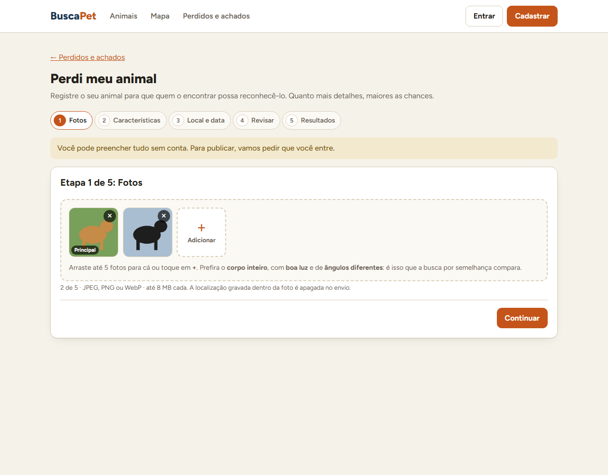
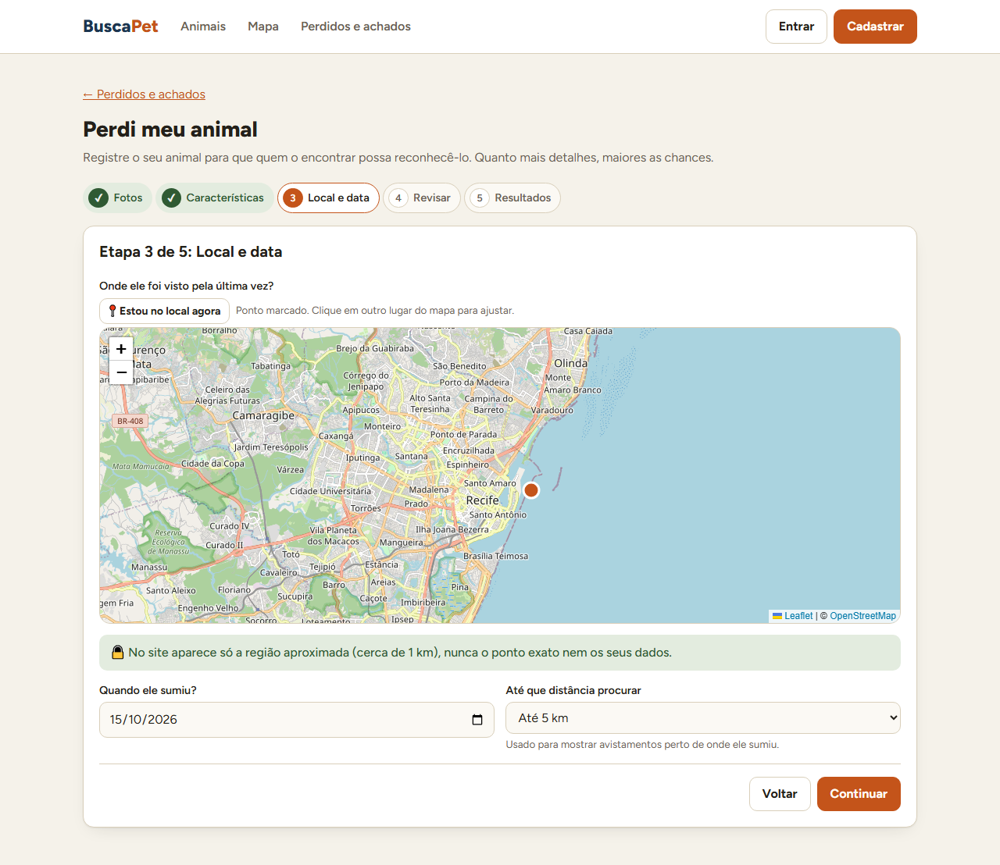
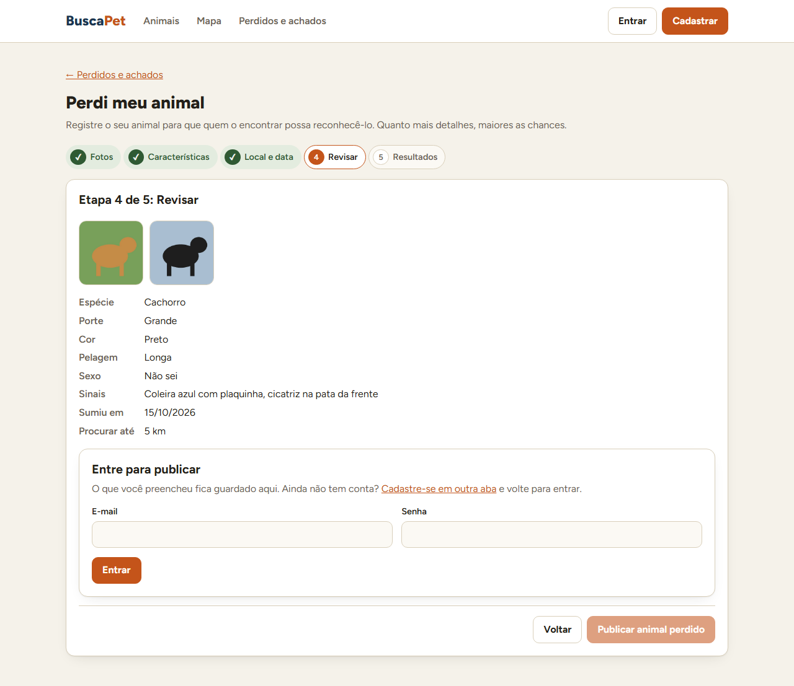
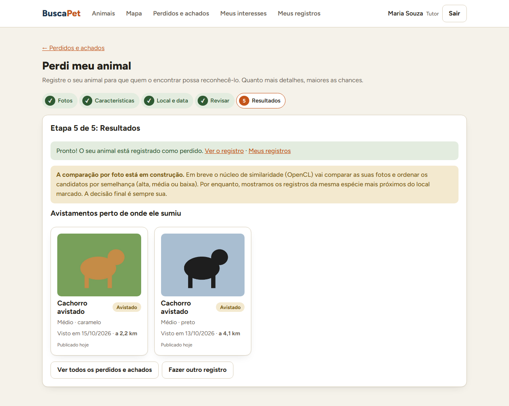
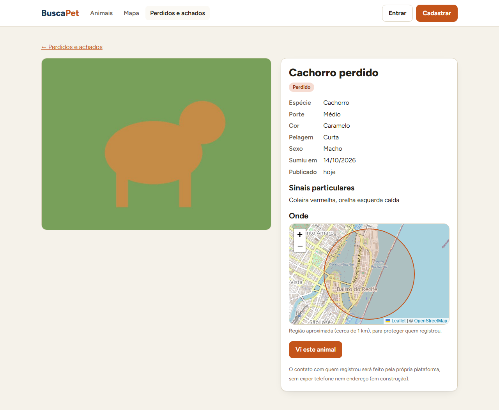
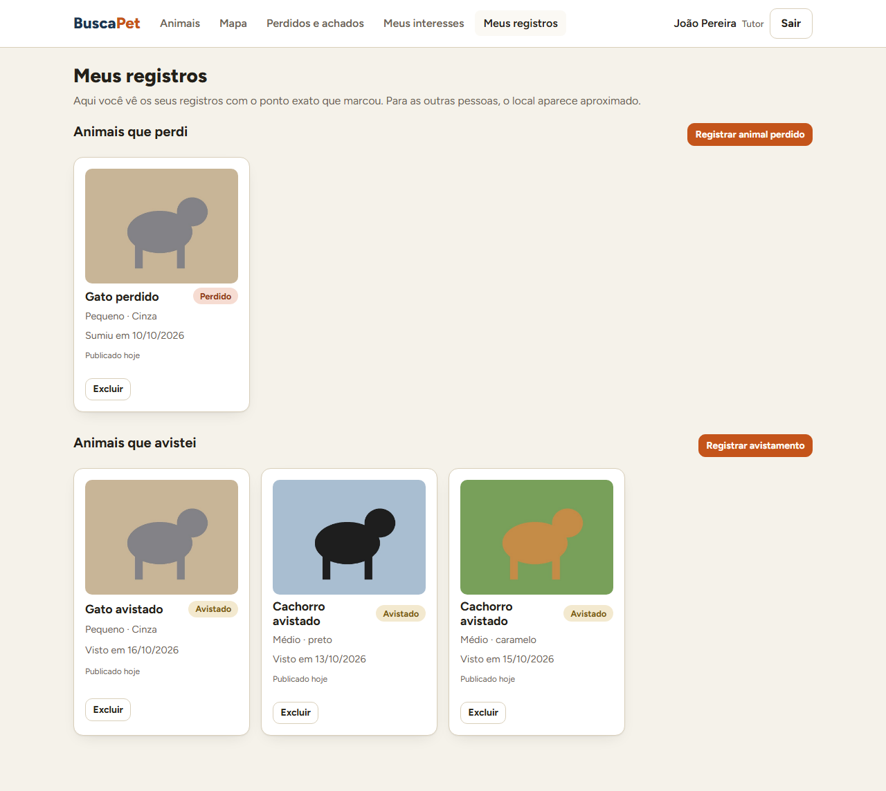
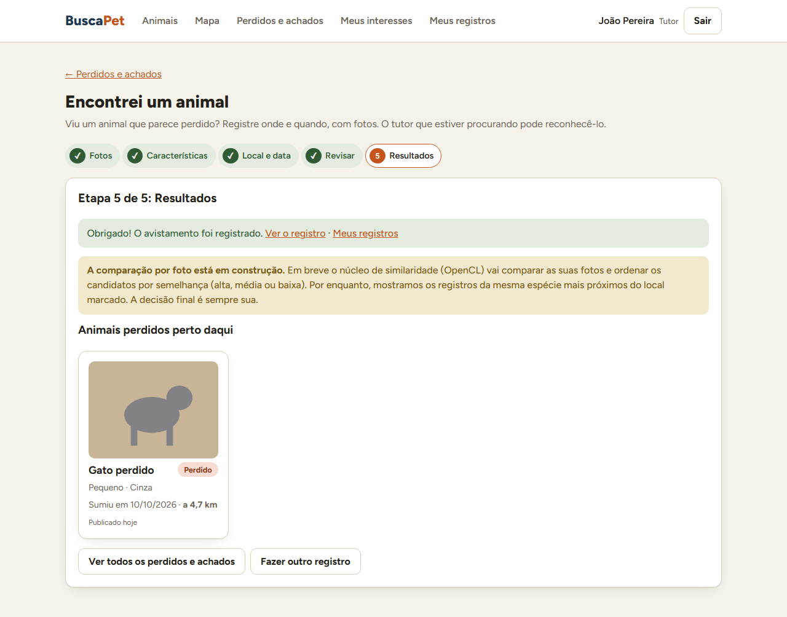
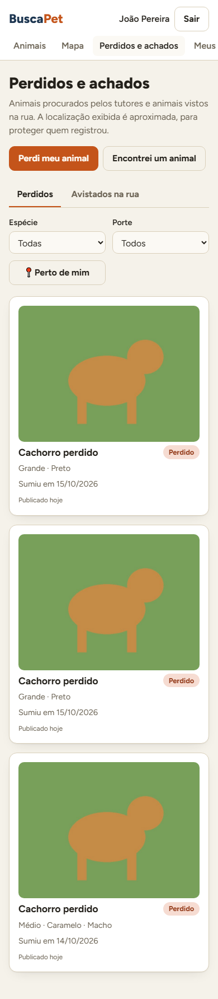

# Telas de perdidos e achados (RF-19 e RF-20)

**Plano interno:** Sprint 3, semana 5 (telas "Perdi meu animal" e "Encontrei um animal").
**Data:** 16/10/2026 · **Responsável:** Kaian (P2), que também cuida do frontend desde 16/10.
**Código:** `BuscaPet-App`, branch `feature/telas-perdi-encontrei` (parte da API de RF-19/20 do PR #5).

> As fotos de animais nas capturas são imagens sintéticas geradas para o teste. As contas são as de
> demonstração (`@exemplo.com`).

---

## 1. O que foi entregue

| Tela | Rota | Para quem |
|---|---|---|
| Lista pública de perdidos e avistados, com filtros e "perto de mim" | `/reencontro` | todos |
| Detalhe do registro: galeria, características, mapa da região | `/reencontro/perdidos/:id` · `/reencontro/avistamentos/:id` | todos |
| Assistente **Perdi meu animal** | `/perdi` | todos preenchem; tutor publica |
| Assistente **Encontrei um animal** | `/encontrei` | todos preenchem; qualquer conta publica |
| Meus registros, com exclusão | `/meus-registros` | tutor, abrigo, apoiador |

## 2. O assistente em 5 etapas

O protótipo da Sprint 2 previa 6 etapas: Fotos, Características, Local, Processando, Resultados e Salvar.
"Processando" e "Salvar" (busca salva) dependem do núcleo OpenCL e do RF-24, por isso hoje o fluxo tem 5
etapas: **Fotos → Características → Local e data → Revisar → Resultados**.

| Etapa 1: Fotos | Etapa 3: Local e data |
|---|---|
|  |  |

| Etapa 4: Revisar (visitante) | Etapa 5: Resultados |
|---|---|
|  |  |

### Decisões de experiência e o porquê

| Decisão | Por quê |
|---|---|
| **Visitante preenche tudo e só entra para publicar**, com um login dentro da etapa de revisão | Ponto 5 em aberto no CONTEXTO §8 (recomendação: sim). Quem perdeu o animal está aflito, e pedir conta antes de começar faz a pessoa desistir. Um login na própria etapa não perde as fotos, o que aconteceria se a pessoa fosse levada a outra página. |
| Validação **por etapa**, antes de avançar | O erro aparece perto do campo e na hora, e não só no fim. Se a API recusar algo, o assistente volta para a etapa do campo com problema. |
| Fotos conferidas no navegador (tipo, 8 MB, máx. 5) | São os mesmos limites da API: a conferência só evita que a pessoa espere o envio para descobrir o erro. A regra de verdade continua na API. |
| Local por **clique no mapa** ou "📍 Estou no local agora" | Quem encontrou um animal normalmente está no local; quem perdeu sabe o ponto e não as coordenadas. |
| Aviso de privacidade na própria etapa | A pessoa vê, antes de publicar, que o público só enxerga a região aproximada (perdido ~1 km, avistamento ~100 m). |
| **Resultados com dados reais** e aviso explícito | O plano permitia dados simulados até o núcleo ficar pronto. Preferimos mostrar registros **reais** da outra base (perdido → avistamentos; avistamento → perdidos), da mesma espécie e perto do local, ordenados por distância, com o aviso "a comparação por foto está em construção". Nada inventado aparece na demonstração. |
| "Sinais particulares" com alerta "não coloque telefone nem endereço" | O texto é público. O contato com quem registrou será feito pela plataforma (escopo §9). |

## 3. Demais telas

| Detalhe (visitante vê região aproximada) | Meus registros (autor) |
|---|---|
|  |  |

| "Encontrei": o gato perdido aparece nos resultados | Celular (390 px) |
|---|---|
|  |  |

## 4. Defeitos encontrados no teste e corrigidos

O teste de ponta a ponta (navegador real controlado por script, ver §5) encontrou quatro defeitos antes da
entrega:

| Defeito | Causa | Correção |
|---|---|---|
| **Datas um dia antes** (14/10 aparecia 13/10). Também afetava a `data_entrada` do animal, que **recuava um dia a cada edição** no painel do abrigo | A API grava meia-noite UTC numa coluna `DateTime` com fuso, e o Postgres devolve no fuso de Recife (21h do dia anterior). Os testes usam SQLite, que não guarda fuso, e por isso não pegaram | Tipo `DataDoDia` (`api/app/schemas/datas.py`): converte para UTC antes de pegar a data. Teste novo simula a leitura do Postgres |
| Miniaturas quebradas na revisão | O endereço temporário da foto (`blob:`) era liberado na montagem dupla que o React faz em desenvolvimento | *Hook* `usePrevias`: cria e libera os endereços no mesmo efeito |
| Mensagem "escolha uma foto" continuava depois de escolher | O erro só era limpo ao avançar | Cada campo limpa o próprio erro quando é alterado |
| Legenda do mapa por baixo do mapa | `top: 1rem` da regra do mapa de abrigos (sticky) deslocava o desenho quando o Leaflet aplica `position: relative` | `top: auto` nos mapas do reencontro |

Também foi ajustado o cabeçalho no celular: o menu passou para uma linha rolável.

## 5. Como foi testado

- `ruff` + `pytest` (80 testes) e `npm run build`, os mesmos passos da CI.
- **Ponta a ponta no navegador:** Chrome *headless* controlado pelo protocolo DevTools, com a API e o banco
  Postgres locais. Roteiros:
  - **Perdi**, como visitante: tentar avançar sem foto e sem campos obrigatórios (erros aparecem), escolher 2
    fotos, marcar o local no mapa, chegar à revisão sem conta (botão de publicar bloqueado), entrar pelo login
    da etapa (as fotos continuam lá), publicar e ver os avistamentos próximos.
  - **Encontrei**, já logado: o login devolve à página de origem (`?voltar=`), publicar um gato avistado e ver o
    gato perdido nos resultados; em seguida, excluir um registro em "Meus registros".
  - Capturas em 1280 px e 390 px (celular).

## 6. O que ainda falta (próximos passos do reencontro)

- **RF-21 a RF-23:** extração de descritores e busca por similaridade. A etapa de resultados passa a mostrar os
  candidatos ordenados por semelhança (alta, média ou baixa).
- **RF-24:** busca salva (etapa "Salvar" do protótipo) e alertas.
- **RF-28:** marcar caso como resolvido (o selo "Resolvido" já aparece se a API indicar).
- Contato com quem registrou, pela plataforma, sem expor dados pessoais.
